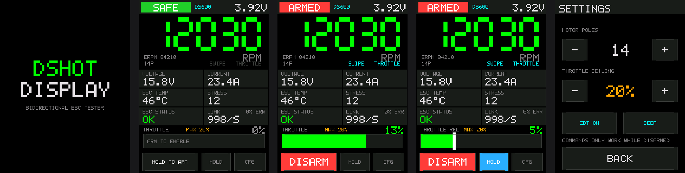
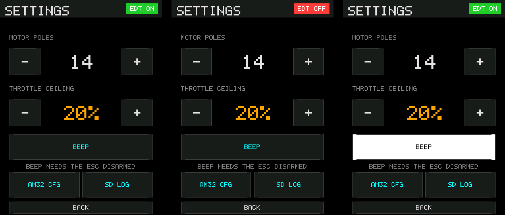
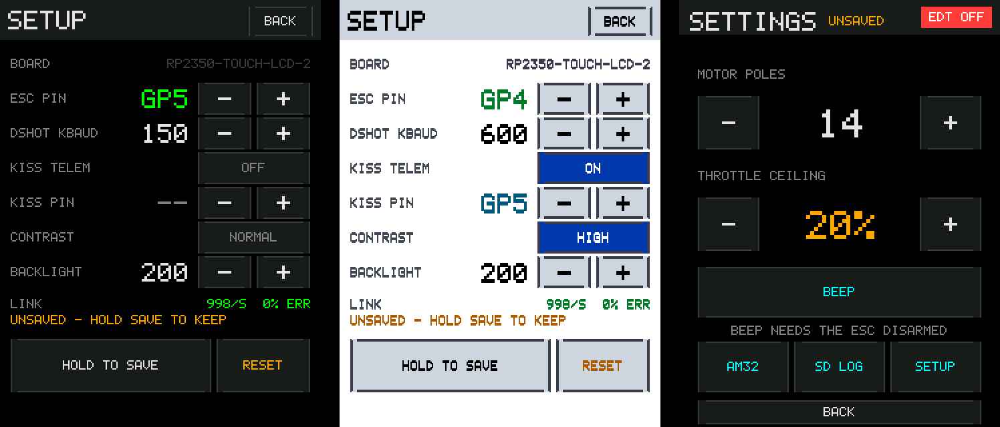
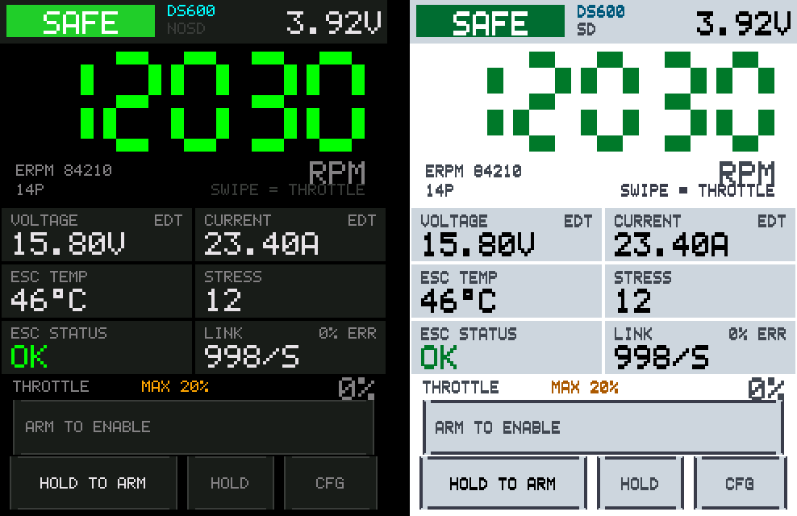
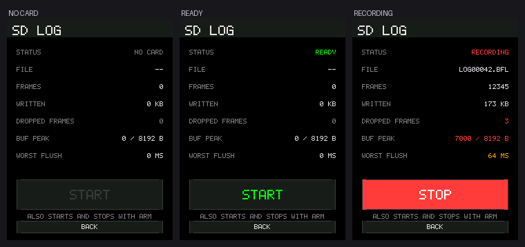
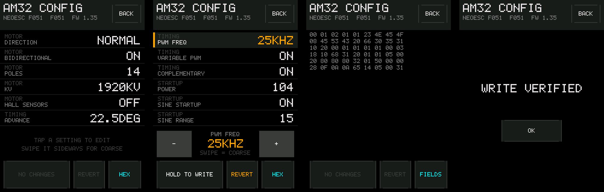

# DshotDisplay

[](https://github.com/subtilitas/DshotDisplay/actions/workflows/ci.yml)

A bidirectional DShot tester for one electronic speed controller (ESC). It runs
on the **Waveshare RP2350-Touch-LCD-2** and **RP2350-Touch-LCD-2.8** and needs
no flight controller, laptop or Betaflight.

The board sends bidirectional DShot to the ESC from an on-screen throttle. On
the same wire it decodes the electrical RPM (eRPM) and Extended DShot Telemetry
(EDT) that the ESC returns: RPM (revolutions per minute), voltage, current, ESC
temperature, stress and status. The touch panel shows all of it.



*The host test suite renders every screenshot here from the UI code.
`tools/make_previews.py` stitches them together.*

> ### [User manual — the Wiki](https://github.com/subtilitas/DshotDisplay/wiki)
>
> **[English](https://github.com/subtilitas/DshotDisplay/wiki/First-Run)** ·
> **[Deutsch](https://github.com/subtilitas/DshotDisplay/wiki/Erste-Schritte)**
>
> Wiring, first run, every screen, telemetry, logging and AM32 configuration,
> for someone using the board. This README describes the firmware and the
> build.

Project state and open items: [STATUS.md](STATUS.md). Changes by release: [CHANGELOG.md](CHANGELOG.md).

---

## Architecture

Bidirectional DShot is half-duplex. The ESC answers only frames it receives,
and it disarms when frames stop. A telemetry display therefore cannot listen
passively. It has to be the throttle source. This makes the device a bench
tester, not an inline monitor.

The display transfers 153,600 bytes per full frame (240 × 320 RGB565 pixels)
over SPI (Serial Peripheral Interface) by DMA (direct memory access). At the
62.5 MHz write maximum in `LCD_SPI_HZ` that is at least 19.7 ms (computed, not
measured). DShot frame timing cannot share a core with that, so the
work is split:

| | core0 | core1 |
|---|---|---|
| Job | touch, rendering, battery sense | DShot frame pump + telemetry decode |
| Rate | 40 Hz (`UI_PERIOD_MS` = 25 ms) | 1 kHz (`DSHOT_PERIOD_US` = 1000 µs) |
| Allowed to block | yes | never |

The two cores share one struct guarded by a `critical_section`. Core0 calls
`escHeartbeat()` every frame. If no heartbeat arrives for
`UI_HEARTBEAT_TIMEOUT_MS` (250 ms), core1 forces the throttle to zero.

---

## Hardware

**Boards:** [RP2350-Touch-LCD-2](https://www.waveshare.com/wiki/RP2350-Touch-LCD-2) (2.0") and
[RP2350-Touch-LCD-2.8](https://www.waveshare.com/wiki/RP2350-Touch-LCD-2.8). Both
have a 240×320 portrait panel. Most other hardware differs. In the table, I2C
is the two-wire Inter-Integrated Circuit bus, PIO is the RP2350's programmable
I/O block, and GPIO means general-purpose input/output pin.

| | 2.0" | 2.8" |
|---|---|---|
| Panel SPI | SPI0 | SPI1 |
| Touch | CST816D on I2C0 (GP12/GP13) | CST328 on I2C1 (GP6/GP7) |
| microSD | hardware SPI1 | 4-bit SDIO (Secure Digital I/O) on PIO |
| Free GPIOs | GP0–GP11, GP21–GP23 | GP28, GP29 |
| Connectors | two 14-pin 2.54 mm headers | JST-SH 1.0 mm only |
| Power latch | none | GP26, asserted first at boot |

### One image for both boards

Build with `-DBOARD=BOARD_UNIFIED`, or download the `unified` release asset.
On every boot the image identifies the board by probing each board's
always-on I2C devices: the QMI8658 IMU (inertial measurement unit) at 0x6B on
both, and on the 2.8" the PCF85063 RTC (real-time clock) at 0x51. The probe
drives the pins open-drain only (see `src/board_probe.h`). **CFG → SETUP**
shows the result, read-only.

The probe runs 3 times (`PROBE_ATTEMPTS`). If no board answers, or both buses
answer, the image stops in a safe state: power latch held, display off, no
DShot output. It remains reachable over USB (Universal Serial Bus) for
reflashing.

The board is not a setting. No stored value can override the probe, so a wrong
stored value cannot build the display or pin map for absent hardware. The
unified image costs a few kilobytes of flash against the 4 MB that
`PICO_BOARD=pico2` declares (`PICO_FLASH_SIZE_BYTES`). The board's physical
flash size is not used by the build and is not stated here.

The single-board builds remain (`-DBOARD=BOARD_RP2350_TOUCH_LCD_2` and
`..._2_8`). They are smaller, CI (continuous integration) builds them, and
they keep the preprocessor path compiling. A single-board image flashed onto
the other board drives the wrong pins. The 2.8" image also asserts the GP26
power latch, which the 2.0" lacks.

The 2.0" is an RP2350A with a 240×320 IPS (in-plane switching)
panel (ST7789T3 over SPI), CST816D capacitive touch, a QMI8658 IMU and a LiPo
charger. The 2.8" uses the same RP2350A and panel with a CST328 touch
controller.

### Pin map (2.0", from the official schematic)

| Function | GPIO | Notes |
|---|---|---|
| LCD (liquid-crystal display) DC / CS / SCK / MOSI / RST | 16 / 17 / 18 / 19 / 20 | SPI0 |
| LCD backlight | 15 | NPN low-side switch, PWM (pulse-width modulation) at 20 kHz, 8-bit |
| Touch + IMU I2C SDA / SCL | 12 / 13 | I2C0, **shared bus** (touch 0x15, IMU 0x6B) |
| Touch INT | 29 | active low |
| Touch RESET | 20 | **same net as LCD_RST**: resetting one resets both |
| Battery sense | 28 | ADC (analog-to-digital converter) input 2, 200k/100k divider → `VBAT = Vadc × 3` |
| microSD | 24–27 | SPI1, blackbox logging, see below. (2.8": SDIO on 19–24) |
| KISS telemetry RX (receive; KISS is a serial ESC telemetry protocol) | 5 | P1 pin 10. Optional third wire. Any free GPIO works |
| Camera bus | 0–11, 21–23 | **free if no camera is fitted** (`BOARD_FREE_GPIO_MASK` = `0x00E00FFF`) |

### Wiring the ESC

Two wires:

| ESC | Board |
|---|---|
| Signal | **GP4**, P2 header pin 11 |
| Ground | **GND**, P2 header pin 13 |

The ESC pin is set on the board under **CFG → SETUP** and stored in flash.
`DSHOT_PIN_LCD_2` in `config.h` is the pin a board with blank flash starts on.
The picker offers the camera-bus pins (GP0–GP11, GP21–GP23) and no others.

Header pinout:

```
P1: 1=GP7  2=GP9  3=GP8  4=GP22 5=GP21 6=GP18* 7=GP23
    8=GP11 9=GP6  10=GP5 11=GP20* 12=GP19* 13=GND 14=5V
P2: 1=3V3  2=GND  3=GP28* 4=GP29* 5=GP13* 6=GP12*
    7=GP2  8=GP1  9=GP3  10=GP0 11=GP4  12=GP10 13=GND 14=VBAT
                                        (* = used by an on-board peripheral)
```

### Plugging an ESC in directly

A 3-pin male header on **P2 pins 11–13** takes a standard servo plug: signal
on GP4, middle position on GP10, ground on pin 13.

> **Cut or depin the middle wire first.** The middle conductor of an ESC lead
> is the BEC (battery eliminator circuit) **+5 V** output. RP2350 GPIO is
> **not** 5 V tolerant. More than about 3.6 V on a pin exceeds the absolute
> maximum rating and damages it. The tester needs signal and ground only.

Three header positions put a GPIO two pins from a ground. Use GP4:

| Candidate | Header run | Use | Reason |
|---|---|---|---|
| **GP4** | P2 11–13: GP4 / GP10 / GND | yes | The signal pin and the skipped middle pin are unused camera-bus pins. No on-board device is connected. |
| GP20 | P1 11–13: GP20 / GP19 / GND | no | GP20 is LCD_RST. DShot on it holds the panel in reset. The middle position is GP19, the LCD's SPI MOSI line. |
| GP29 | P2 4–2: GP29 / GP28 / GND | no | GP29 is the CST816D's INT **output**. The touch chip drives it low on every touch and conflicts with the ESC. The middle position is the battery-ADC divider node. |

Neither header has a `[GPIO][5V][GND]` run, so a fully populated servo plug
does not fit any pin. 5 V and GND are adjacent only at P1 pins 14 and 13.
Remove the BEC wire.

**Power the ESC from its own battery.** Do not power a motor from the board's
5 V pin. Connect the ESC ground to the board ground, and keep the signal wire
short. The maximum working lead length is not measured. If the **LINK** error
rate rises, set **DSHOT KBAUD** to 300 under **CFG → SETUP**.

### The 2.8" board

Its pin map is `src/board_rp2350_touch_lcd_2_8.h`. It has no 2.54 mm headers.
All signals are on JST-SH connectors, and only **GP28** (J4 pin 11) and
**GP29** (J4 pin 12) are free. The ESC starts on **GP29**, the last pin on the
connector. The KISS telemetry wire starts on **GP28**.

To swap them, build with `-DDSHOT_PIN_LCD_2_8=28 -DKISS_PIN_LCD_2_8=29`. The two
must move together. A build that puts both on one pin fails a `static_assert`.

An ESC on the wrong one of the two pins produces no error. **LINK** stays at
`0/S`.

The board has a power-button latch on GP26 (`PIN_BAT_EN`). The firmware drives
it high as the first action at boot. Without it, the board loses power when
the button is released while running on battery. On USB the latch has no
effect.

---

## Building

Native [Pico SDK](https://github.com/raspberrypi/pico-sdk) with CMake. No
Arduino core, no IDE.

Requirements: `cmake` 3.18 or later, `ninja` and an `arm-none-eabi` toolchain.

```sh
sudo apt install cmake ninja-build gcc-arm-none-eabi   # Debian/Ubuntu
brew install cmake ninja arm-none-eabi-gcc             # macOS
```

Fetch the SDK once and set `PICO_SDK_PATH`:

```sh
git clone --depth 1 --branch 2.1.1 https://github.com/raspberrypi/pico-sdk.git ~/pico-sdk
git -C ~/pico-sdk submodule update --init --depth 1 lib/tinyusb
export PICO_SDK_PATH=~/pico-sdk
```

`lib/tinyusb` is required. Serial telemetry runs over USB CDC (communications
device class). Without the submodule the SDK builds with no USB support and
reports no error.

Build:

```sh
cmake -B build -G Ninja -DPICO_BOARD=pico2 -DPICO_PLATFORM=rp2350-arm-s .
ninja -C build
```

Build options:

```sh
-DBOARD=BOARD_UNIFIED                # one image for both boards
-DBOARD=BOARD_RP2350_TOUCH_LCD_2_8   # the 2.8" board only; default is the 2.0"
-DDSHOT_PIN_LCD_2_8=28               # the ESC pin a blank board starts on
-DKISS_PIN_LCD_2_8=29                # ...and the telemetry pin, per board
-DSTRICT=ON                          # warnings fatal, for this project's sources
```

The ESC pin defaults to **GP4** on the 2.0" (`DSHOT_PIN_LCD_2`) and **GP29** on
the 2.8" (`DSHOT_PIN_LCD_2_8`). Each board has its own option because a
unified image carries both board descriptors. The boot probe selects which
descriptor, and so which defaults, a running board uses.

The output is `build/DshotDisplay-<board>.uf2`, where `<board>` is
`touch-lcd-2`, `touch-lcd-2.8` or `unified`. UF2 is the USB Flashing Format.
The images are not interchangeable between boards, except `unified`.

To flash: hold **BOOT**, tap **RESET**, release **BOOT**, and copy the `.uf2`
onto the USB drive that appears.

`-DSTRICT=ON` adds `-Werror` for this project's own sources. CI sets it. It is
off by default, so a toolchain update that adds a warning does not stop a
local build.

Only the Cortex-M33 build (`rp2350-arm-s`) is supported. The DShot library
also supports the RP2350's Hazard3 RISC-V cores, but this project does not
build or test for them.

### Prebuilt images

Every [release](https://github.com/subtilitas/DshotDisplay/releases) has a
`.uf2` per image attached. Flash it as above.

Every green CI run uploads a `.uf2` artifact per image, so an untagged commit
can be tested on hardware.

`tools/sdtest` is not among them. It is a bench diagnostic for the SD card
wiring, not firmware. A plain `ninja -C build` builds it locally next to the
firmware.

### Reproducible builds

`CMakeLists.txt` pins each dependency and fetches it at configure time. The
tree contains no third-party source.

| Dependency | Version | Pinned by |
|---|---|---|
| pico-sdk | 2.1.1 | commit SHA (hash) |
| Pico_Bidir_DShot | 1.0.2 | commit SHA |
| no-OS-FatFS-SD-SDIO-SPI-RPi-Pico | v3.6.2 | commit SHA |

Each SHA has its tag in a comment beside it. A tag can be moved; a SHA cannot.

Two constraints on these dependencies:

- The FatFs driver has its `CMakeLists.txt` one directory below the repository
  root, so it needs `SOURCE_SUBDIR`. Without it `FetchContent` downloads the
  source, defines no targets, and the build fails later on a missing header.
- The SD driver is the **SDIO-SPI** repository, not the older SPI-only one. The
  SPI-only driver's `rtc.c` includes `hardware/rtc.h`. The RP2040 has that RTC
  peripheral; the RP2350 does not (it has powman instead), so that driver fails
  to compile for the RP2350.

---

## Using it

**Main screen**

- **HOLD TO ARM**: press and hold for 1 s (`ARM_HOLD_MS`). Arming is refused
  unless the throttle has been at zero for 250 ms (`ARM_ZERO_THROTTLE_MS`).
  Once armed the button reads **DISARM** and acts on touch-down.
- **Throttle bar**: the gesture depends on HOLD.

  | | HOLD off (default) | HOLD on |
  |---|---|---|
  | Bar label | `THROTTLE` | `THROTTLE REL` + grab handle |
  | Gesture | **absolute**: finger position sets the throttle | **relative**: throttle moves by the finger's travel |
  | Touching the bar | jumps to that position | changes nothing |
  | On release | returns to zero | stays |

  The bar is 34 px tall (`THR_TRACK_H`). The outer 16 px at each end
  (`THR_EDGE_SAT`) count as the rail, so zero and the ceiling are reachable
  with a finger. Relative drags accumulate across several swipes and
  re-anchor at both rails. `HOLD_DRAG_SENSITIVITY_PCT` (default 100) sets how
  much of the ceiling one track width of travel covers.

  The percentage shown is of the full 0–2000 DShot range. The bar's full width
  is the configured ceiling.
- **Throttle pad**: the area above the gauge (RPM readout and telemetry tiles)
  is a relative throttle surface in both modes. Swipe **up** for more,
  **down** for less. Swipes accumulate.

  A tap on the pad never changes the throttle. A drag engages after 6 px of
  travel (`PAD_DEADZONE_PX`). One full-height swipe covers 60 % of the ceiling
  (`PAD_DRAG_SENSITIVITY_PCT`).

  The pad ends where the gauge's grab area begins, with no overlap and no gap.
  The hint under the RPM readout reads `SWIPE = THROTTLE`, cyan while armed,
  and changes to `SWIPE ACTIVE` in green while a drag is engaged.
- **HOLD**: off by default. Turning it off sets the throttle to zero.
- **CFG**: settings and **SETUP**. Opening it disarms.

**Button behaviour**

Every button except DISARM acts on release and shows a pressed outline while
held. Sliding off before release cancels the press.

DISARM acts on touch-down.

The `-` / `+` steppers step once on press. After 400 ms held
(`REPEAT_DELAY_MS`) they repeat every 120 ms, after 1.2 s every 60 ms, and
after 2.5 s every 25 ms.

Arming and disarming dim the backlight to a quarter for 120 ms
(`BL_DIP_MS`), so the event is visible while watching the motor.

**Settings screen**



*EDT live, EDT silent, and BEEP acknowledging a press.*

- **Motor poles**: eRPM to RPM is `RPM = eRPM / (poles / 2)`. Range 2–28, even
  values only. Default 14.
- **Throttle ceiling**: default 20 % (400 of 2000). Steps of 5 %, range
  5–100 %.
- **EDT ON / EDT OFF**: a read-only chip under the title. Green while EDT
  frames arrive, red otherwise. The firmware sends the enable command itself
  (see [Telemetry and logging](#telemetry-and-logging)). The ESC does not
  acknowledge the command, so the chip shows received frames, not sent
  commands.
- **BEEP**: sends `DSHOT_CMD_BEACON1` for 6 frames (`BEEP_REPEATS`), 6 ms at
  1 kHz. Use it to identify which ESC is connected. Refused while armed; the
  caption then reads `REFUSED - DISARM THE ESC FIRST`.
- **AM32**: the ESC settings editor. See [AM32 ESC configuration](#am32-esc-configuration).
- **SD LOG**: logging status and manual start/stop. See below.
- **SETUP**: ESC and telemetry pins, DShot bitrate, contrast, backlight, and
  the button that writes all settings to flash. See below.
- **UNSAVED** on the strip under the title means a value on this screen or on
  SETUP differs from flash. The save button is on SETUP.

A BEEP press highlights the button for 350 ms (`CMD_FLASH_MS`): white when
sent, amber when refused. Without it a 6 ms command is not visible against a
25 ms repaint.

**SD LOG screen**

- **STATUS**: `NO CARD`, `READY`, `RECORDING` or `CARD ERROR`. The boards have
  no card-detect pin, so the firmware learns of a card only by mounting it.
- **START / STOP**: starts or ends a log. Disabled with no card.
- **FILE**, **FRAMES**, **WRITTEN**: the open file, frames logged, kB written.
- **DROPPED FRAMES**: frames the ring buffer refused because the card was
  slower than the data. Red when non-zero. Non-zero means the buffer is too
  small for that card.
- **BUF PEAK**: buffer high-water mark against `SD_LOG_BUFFER_BYTES`. Amber
  above 1/2, red above 3/4.
- **WORST FLUSH**: the longest single card write, in ms. Amber above 50 ms.
- **CARD**: card type and size. **MOUNT**: the FatFs result code and name,
  for example `0 OK`, `3 NOT READY`, `13 NO FILESYSTEM`.
- **RETRY**: mounts again. The card is otherwise mounted only once, at boot.
- **USB DRIVE**: serves the card to the USB host. See
  [Blackbox logging to microSD](#blackbox-logging-to-microsd).

**SETUP screen**



*SETUP, the same screen in high contrast, and the UNSAVED marker it puts on the
settings screen.*

| Row | What it does |
|---|---|
| **BOARD** | The board the boot probe detected. Read-only on every image |
| **ESC PIN** | GPIO for the DShot signal. Steps through this board's free GPIOs only, skipping the KISS pin while KISS is on |
| **DSHOT KBAUD** | 150 / 300 / 600 / 1200, wrapping at the ends. Applies at once: the driver is rebuilt on the new pin and rate before the next frame |
| **KISS TELEM** | Whether to listen for the telemetry wire. Turning it on moves the KISS pin off the ESC pin if they coincide |
| **KISS PIN** | Steps through the same free GPIOs, skipping the ESC pin. The receiver is a PIO state machine, so any free GPIO works |
| **CONTRAST** | `NORMAL` or `HIGH`. See below |
| **BACKLIGHT** | 16–255 in steps of 32. High contrast forces 255 while on |
| **LINK** | Live packets per second and checksum error rate. Green when packets arrive, amber above 5 % errors |

A wrong ESC pin produces no error: the ESC receives no frames. **LINK** on this
screen shows the result of each pin change. A non-zero packet rate means the
pin is correct.

**HOLD TO SAVE** (1 s, `SAVE_HOLD_MS`) writes all settings to flash: the rows
above plus pole count and throttle ceiling. Erasing the flash sector stops
core1, and with it the DShot pump, for the length of the erase. That duration
is not measured. Saving is refused while armed (`NOT WHILE ARMED - DISARM TO
SAVE`). **RESET** loads the compiled defaults into the live settings. Flash
changes only on the next save.

Every value applies when changed. Only persistence needs the hold, so a value
can be tried and then discarded by leaving without saving. The note line reads
`SAVED SETTINGS IN USE` or `COMPILED DEFAULTS IN USE`.

**High contrast**



*The tester screen in the normal and the high-contrast palette.*

High contrast is black on white. Accents are darkened to carry white text,
every glyph stroke gets one extra pixel of weight, frames are 2 px, the
seven-segment stroke is thicker, and the backlight is forced to 255. It is
meant for direct sunlight on the transmissive IPS panel.

The palette has fewer distinct greys than the dark one. Label greys are
merged so that labels stay legible outdoors.

The extra glyph weight is a 1 px vertical smear. The 5×7 font sits in a 6 px
cell, so a horizontal smear would close the gap between glyphs. A vertical
smear adds no width, so no layout changes.

**Reading the telemetry**

`--` means no source has supplied that field within its timeout. Plain eRPM
works on any bidirectional DShot ESC. Voltage, current, temperature, stress and
status need EDT support in the ESC firmware (BLHeli_32, Bluejay, AM32). The
**LINK** tile shows good packets per second and the checksum error rate over
the last second. At 1 kHz a clean link reads close to `1000/S` and `0% ERR`.
A rising error rate points at signal integrity.

The voltage and current tiles carry a source tag: **KISS** (cyan) or **EDT**
(dimmed). EDT reports voltage in 0.25 V steps and KISS in 0.01 V steps. A tag
that drops from KISS to EDT means the telemetry wire has stopped, and the
reading is 25 times coarser. Consumption in mAh appears on the temperature
tile with KISS only. EDT does not carry it.

The tester's top row shows `DS` plus the bitrate, cyan once an EDT enable has
been sent. **Current limitation:** this label shows the compiled default
(`DSHOT_SPEED_KBAUD`, `DS600`), not the rate set under SETUP.

---

## Telemetry and logging

The firmware enables EDT itself. There is no button. While an ESC answers with
eRPM and no EDT frame has arrived for `EDT_STALE_MS` (1000 ms), the enable is
sent again every `EDT_RETRY_MS` (1000 ms). After `ESC_LINK_STALE_MS` (500 ms)
without eRPM the state resets. An ESC connected later, power-cycled or
replaced then gets its own enable.

Each enable is `EDT_ENABLE_REPEATS` (10) identical frames. It is sent only
when all of these hold:

- the link has been up for `EDT_SETTLE_MS` (300 ms). An ESC answers eRPM
  within milliseconds of power-up but executes commands only after a run of
  valid zero-throttle frames;
- the tester is disarmed and eRPM is zero. DShot commands execute only with
  the motor stopped, and a motor coasts for seconds after a disarm;
- no other command is on the wire. An ESC executes a command only after a run
  of identical frames, so a BEEP inside an enable would break both.

Every reading expires. An EDT field not refreshed for `EDT_STALE_MS` (1 s)
shows `--`. RPM shows a dark red zero, and the line under it reads
`NO TELEMETRY`, after `ESC_LINK_STALE_MS` (500 ms) without eRPM. A display that
held old values would show a plausible reading from an ESC that is no longer
connected.

An expired **ESC STATUS** reads `--`, never `OK`.

Bidirectional DShot and EDT work on hardware. No defect is known as of v2.3.

### KISS telemetry (optional third wire)

EDT rides in the eRPM frame and needs no extra wire. Its resolution is 0.25 V
and 1 A. On a 6S pack a 200 mV sag is below one step, and idle current reads
0 A.

An ESC with KISS telemetry (BLHeli_32 and AM32 implement it) sends a 10-byte
frame at 115200 baud on a separate wire when the DShot frame requests it. The
frame carries voltage and current in 0.01 V and 0.01 A steps, plus consumed
mAh, which EDT does not carry.

| ESC | Board |
|---|---|
| Telemetry pad | **GP5**, P1 header pin 10 (2.0"); **GP28**, J4 pin 11 (2.8") |

The line is transmit-only from the ESC. Requests go out every 20th DShot frame
(`KISS_REQUEST_EVERY_N`), which is 50 Hz at 1 kHz.

**Status:** reported working by a user on the 2.0" board; not tested by the
project. It is off by default on the 2.8" (`KISS_ENABLE_LCD_2_8` = 0) because
that board has two free pins and the ESC uses one.

**Any free GPIO can receive it.** The receiver is a UART (universal
asynchronous receiver-transmitter) built from one PIO state machine. The
RP2350's two hardware UARTs receive only on GPIOs where `n % 4 == 1`, which on
the 2.8" leaves only GP29, the ESC pin. See `src/pio_uart_rx.h`.

The tiles fall back from KISS to EDT `KISS_STALE_MS` (500 ms) after the last
KISS frame.

> **Voltage.** The KISS specification puts this line at 3.6 V, which equals the
> RP2350's absolute-maximum GPIO voltage. The level a given ESC drives is not
> measured by this project. Measure yours before connecting it, and consider a
> 1 kΩ series resistor.

RPM is **not** taken from KISS. KISS arrives at 50 Hz and bidirectional DShot at
1 kHz, and spin-up, oscillation and desync show in the 1 kHz stream. KISS
resolves 100 eRPM. Bidirectional DShot encodes a period with a 9-bit mantissa,
so its step grows with RPM. Above about 5,500 mechanical RPM on a 14-pole motor
(about 6,500 on 12 poles, 4,800 on 16) the KISS step is finer. The log
records both. The arithmetic is in `docs/design/erpm_resolution.py`.

### Blackbox logging to microSD

Logs are written in Betaflight's blackbox format. They open in
[**logwiju**](https://subtilitas.github.io/logwiju/), the viewer written for
them, and in Blackbox Explorer, `blackbox_decode` and PIDtoolbox. Files are
named `LOGnnnnn.BFL` on a card formatted with FAT (File Allocation Table). Each new file takes the lowest
unused number from 00001 to 09999. Existing files are not overwritten.



The 2.0" drives the card over hardware SPI at 12 MHz (`SD_LOG_SPI_MHZ`). The
2.8" uses 4-bit PIO SDIO at 10 MHz (`SD_LOG_SDIO_HZ`). The 2.8" cannot use
hardware SPI: its SD clock is on GP19, which is SPI0 TX in the pin mux.

Open the screen with **CFG → SD LOG**. By default arming starts a log and
disarming stops it (`SD_LOG_AUTO_ON_ARM`). Auto-stop ends only a log that
auto-start began. **START/STOP** is always available.

At the default 500 Hz (`SD_LOG_RATE_HZ`) a frame averages 14.5 bytes
(measured). That is 7.3 kB/s, or 26 MB per hour.

Size the buffer from **BUF PEAK** and **WORST FLUSH**. `SD_LOG_BUFFER_BYTES`
defaults to 8192 bytes, about 1.1 s at 7.3 kB/s. Whether that covers a given
card's erase stalls is not measured. A peak near the buffer size, or a flush
longer than the buffer covers, means raise it. **DROPPED FRAMES** above zero
means it was too small.

The logger drops frames rather than block. The UI never waits for the card.

**Getting the files off:** **CFG → SD LOG → USB DRIVE** presents the card to
the USB host as a read-only removable drive, using MSC (mass storage class) on
the same USB cable as the serial port. The logger unmounts before the drive
appears and touches the card again only after eject. The host and the
firmware never share the FAT volume. The request is refused while armed
(`DISARM FIRST`), while recording (`STOP RECORDING FIRST`) or with no card
(`NO CARD TO SHARE`). Arming is blocked while the host holds the card. See
`src/usb_msc.h`.

### Tuning

All in `config.h`. Unless a row says otherwise, a default is a starting value,
not one derived from measurement.

Six of these are only *defaults*: the ESC pin, the DShot bitrate, the KISS
wire, the pole count, the throttle ceiling and the backlight. Each can be
changed under **CFG → SETUP** and stored in flash. On a board with saved
settings the stored value wins, so editing `config.h` and reflashing changes
nothing for those six. The SETUP note line says which set is in use.

| Setting | Default | What it does |
|---|---|---|
| `DSHOT_PIN_LCD_2` | `4` | ESC signal GPIO the 2.0" board starts on |
| `DSHOT_PIN_LCD_2_8` | `29` | ESC signal GPIO the 2.8" board starts on |
| `KISS_TELEM_ENABLE` | `1` | Compile the KISS path in at all |
| `KISS_ENABLE_LCD_2` | `1` | Whether the 2.0" board listens for a KISS wire. It has 15 free GPIOs |
| `KISS_ENABLE_LCD_2_8` | `0` | Whether the 2.8" board does. **Off**: the board has two free pins and the ESC takes one. One tap under SETUP turns it on |
| `KISS_PIN_LCD_2` | `5` | GPIO for the telemetry wire, 2.0" board. Receive only, any free GPIO, changeable under SETUP |
| `KISS_PIN_LCD_2_8` | `28` | Same for the 2.8". The other of its two free pins; `DSHOT_PIN_LCD_2_8` has GP29 |
| `KISS_REQUEST_EVERY_N` | `20` | Request every Nth DShot frame; 20 at 1 kHz is 50 Hz. Values below 2 overlap replies and fail an `#error` |
| `KISS_STALE_MS` | `500` | How long a KISS frame stays in use before the display falls back to EDT |
| `EDT_STALE_MS` | `1000` | How long an EDT field stays valid after its last frame. Then the tile shows `--` |
| `ESC_LINK_STALE_MS` | `500` | Time without eRPM before the ESC counts as gone. Resets the automatic EDT enable |
| `EDT_RETRY_MS` | `1000` | Interval between EDT enables while eRPM arrives and EDT does not |
| `EDT_SETTLE_MS` | `300` | Time the link must be up before the first EDT enable |
| `KISS_REPLY_TIMEOUT_MS` | `10` | Abandon an incomplete reply after this long; affects only the timeout counter |
| `SD_LOG_ENABLE` | `1` | Compile the logging path in at all |
| `SD_LOG_SPI_MHZ` | `12` | Card clock on the 2.0". Cards are specified to 25 MHz in SPI mode |
| `SD_LOG_SDIO_HZ` | `10 MHz` | Card clock on the 2.8", where `SD_LOG_SPI_MHZ` is ignored |
| `SD_LOG_RATE_HZ` | `500` | Log frame rate. eRPM is the only 1 kHz signal |
| `SD_LOG_I_INTERVAL` | `32` | Frames between keyframes (I frames). Lower values resynchronise sooner after damage and cost size |
| `SD_LOG_BUFFER_BYTES` | `8192` | Ring buffer. Size it from BUF PEAK and WORST FLUSH |
| `SD_LOG_CHUNK_BYTES` | `512` | Flush size. Keep it a multiple of 512 to avoid read-modify-write in the card |
| `SD_LOG_PREALLOC_BYTES` | `16 MB` | Contiguous space reserved per file, so the FAT is not rewritten mid-log. About 38 min at 7.3 kB/s. Unused space is released at close |
| `SD_LOG_SYNC_MS` | `2000` | Interval for committing the file's directory entry. A power cut loses at most the data since the last commit |
| `SD_LOG_AUTO_ON_ARM` | `1` | Start and stop logging with ARM, in addition to the manual button |

### Reading the logs

Files are written to the card root as `LOGnnnnn.BFL`.

<div align="center">

[](https://subtilitas.github.io/logwiju/)

### **[logwiju](https://subtilitas.github.io/logwiju/)** — the viewer for these logs

</div>

Drop a `.BFL` file onto the page to plot it. It needs no install, upload or
account, and the file stays in the browser. Wheel zooms, drag pans,
shift+drag zooms to a box, double-click fits. The side panel selects fields.

The name, read in German (`w` as English *v*, `j` as English *y*), sounds like
"logview". The tail is **WI**ngert **JU**lian.

The logs also open in
[Blackbox Explorer](https://github.com/betaflight/blackbox-log-viewer), or on the
command line:

```sh
blackbox_decode LOG00001.BFL      # -> LOG00001.01.csv and .01.event
```

The `.event` file holds the end-of-log marker. The CSV (comma-separated values) file holds the data.

Fields per frame: `loopIteration`, `time`, `motor[0]` (throttle), `eRPM[0]`,
`eRPMkiss[0]`, `vbatLatest`, `amperageLatest`, `vbatEdt`, `amperageEdt`,
`escTemperature[0]`, `escConsumption` and `escStress`.

Both eRPM sources are logged: `eRPM[0]` (bidirectional DShot, 1 kHz) and
`eRPMkiss[0]` (KISS, 50 Hz). Both voltage and current sources are logged:
`vbatLatest` / `amperageLatest` carry KISS where it was live, `vbatEdt` /
`amperageEdt` always carry EDT. This allows the KISS decoder to be checked
against EDT from the log itself.

## AM32 ESC configuration

**CFG → AM32** reads and edits an AM32 ESC's settings over the signal wire. It
does not flash ESC firmware. The transport is `src/am32_bl.h`.



Entering the screen disarms, stops the DShot driver and hands the signal pin to
the bootloader transport. Leaving hands it back.

### Connecting

Open the screen, then power-cycle the ESC. The AM32 bootloader listens only in
a short window after power-up. The firmware repeats the 21-byte init string,
waiting 30 ms (`AM32_GREET_TMO_MS`) for each reply, so that it is sending when
the window opens. The window's length is not measured.

`AM32_FORCE_LOW_JUMP` (default 0) instead holds the signal low for
`AM32_BOOT_LOW_MS` (200 ms) once before the first attempt. The reference
configurator does not do this, and the firmware cannot receive while it holds
the line.

The screen shows which half failed:

| Message | Meaning | What to change |
|---|---|---|
| `WAITING... (TRY n)` | No reply yet | Power-cycle the ESC while the screen is open |
| `REPLY NOT UNDERSTOOD:` followed by `nB: xx xx xx @19200` | The ESC sent bytes that did not parse | Baud rate or framing. The first three bytes are shown |
| `READ FAILED (...)` | Handshake succeeded, settings read failed | Retry; check the wire |
| `NO VALID SETTINGS` | The settings block is implausible | Do not write |

`AM32_DEBUG` (default 1) mirrors every transport step to USB serial.

### Editing

| Gesture | Effect |
|---|---|
| Tap a row | Selects it; the editor bar at the bottom shows its name and value |
| **Swipe the row sideways** | **Coarse**: 180 px of travel covers the field's whole range |
| `-` / `+` buttons | **Fine**: one step per press; hold to repeat, accelerating |
| Drag up/down | Scrolls the list 1:1 with the finger |

A press selects nothing on its own. It becomes a selection on release if the
finger did not move, or when a sideways swipe is recognised, so a swipe adjusts
the row it started on. A vertical drag never selects.

The axis locks after 6 px of travel (`AXIS_LOCK_PX`), so a gesture is either a
scroll or an edit. Scrolling is measured from the touch point, so no travel is
lost to the lock. Coarse swipes snap to each field's step, so motor poles stay
even. They re-anchor at the ends of the range.

Changed rows are marked amber on the left edge. **REVERT** restores the values
that were read. **HEX** shows the raw 48 bytes for checking a field's
decoding.

Writing needs a 1 s hold on `HOLD TO WRITE`. After the write the firmware
waits `AM32_WRITE_SETTLE_MS` (300 ms), reads the block back, and compares it
byte for byte. It shows `WRITE VERIFIED` only on a full match. On a mismatch it
shows the first differing byte: `DIFF @xx: GOT xx WANT xx`.

### Protocol

| | |
|---|---|
| Link | one-wire half-duplex serial, 19200 8N1, on the ESC signal pin |
| Init string | 21 bytes: twelve `0x00`, `0x0D`, `"BLHeli"`, `0xF4 0x7D` |
| Commands | `SET_ADDRESS 0xFF 00 hi lo`, `SET_BUFFER 0xFE 00 00 len`, `PROG_FLASH 0x01 0x01`, `READ_FLASH 0x03 len`, `ERASE 0x02`, `RUN 0x00` |
| Checksum | CRC-16/ARC (cyclic redundancy check): polynomial `0xA001`, init 0, appended low byte first |
| ACK (acknowledge) | `0x30`, always the last byte received |
| Settings | 48 bytes, at an address that depends on the MCU (microcontroller) |

The settings address depends on the MCU family. The handshake reply gives the
family in its fifth-from-last byte:

| Type byte | Family | Settings at |
|---|---|---|
| `0x2B` | STM32G071, 2 KB pages | `0x7E00` |
| `0x1F` | STM32F051, 1 KB pages | `0x7C00` |
| `0x35` | STM32F3, 2 KB pages | `0xF800` |

The reply is indexed from the end. A host with a hardware UART on the shared
wire also captures its own transmission, so only the tail is at a fixed
position.

Bytes `0x05..0x0C` hold the device name before layout revision 3, and ramp and
current-PID (proportional-integral-derivative controller) settings from revision 3 on. Fields are gated by revision, so only
the set that applies is shown.

Host and ESC share one conductor, so every transmitted byte is echoed back and
discarded before the reply is read. Interrupts are masked per byte, not per
frame. One byte at 19200 8N1 is 0.52 ms; masking for a whole frame would block
the system for several milliseconds.

### Verification

The host test harness runs two cross-checks:

- Every protocol constant is asserted against a known-working Python
  configurator: init string, all six command encodings, CRC polynomial and
  byte order, ACK position, and all three MCU-to-address mappings.
- The field table is decoded against that tool's default settings blob and
  compared to the meanings in its byte comments: 14 poles, 24 kHz, 2200 KV,
  15° advance, 3.0 V cell cutoff, 1502 µs servo neutral, 204 A current limit,
  and others.

---

## Safety

A motor on a bench can injure, and more so with a propeller fitted.

In the firmware:

- Boots disarmed and sends `MOTOR_STOP` (throttle 0) continuously.
- Arming needs a 1 s hold with the throttle at zero for at least 250 ms.
- With HOLD off, the throttle returns to zero on finger lift.
- Throttle ceiling, default 20 %.
- Auto-disarm after 30 s with no touch input (`IDLE_DISARM_MS`). For the last
  5 s, `IDLE ns` replaces the battery voltage in the top row.
- Core1 sets the throttle to zero if core0 sends no heartbeat for 250 ms.
- Opening CFG disarms. The wiring settings are reachable only from there.
- A settings save is refused while armed, because erasing flash stops the
  DShot pump.
- A stored settings block that fails its CRC, version or size check is
  discarded whole and the compiled defaults are used. Fields are never merged
  one by one, so a corrupted byte cannot raise the throttle ceiling.
- Arming is blocked while a USB host holds the SD card.

Not in the firmware:

- Remove the propeller unless the test needs it.
- Clamp the motor down.
- Wear eye protection and stay out of the plane of rotation.
- Keep a way to cut battery power that does not depend on the touchscreen.

The software interlocks back up these habits. They do not replace them.

---

## Layout

```
CMakeLists.txt          build + pinned dependency versions
pico_sdk_import.cmake   locates the SDK via PICO_SDK_PATH
src/
  main.cpp              core0 main(), core1 launch, @page architecture
  plat.h                millis/micros/delay over the SDK timebase
  config.h              defaults for every tunable setting
  settings.{h,cpp}      the persisted subset: rules, validation, fallback (pure)
  settings_flash.cpp    the one flash sector those live in
  theme.{h,cpp}         the two palettes and the stroke weights
  board.h               which board(s) this build can drive
  board_pins.h          dispatches to the per-board pin map (single-board builds)
  board_rp2350_touch_lcd_2{,_8}.h   the pin maps themselves
  board_desc.{h,cpp}    the board as data, so one image can drive either
  board_desc_lcd2{,_8}.cpp  one descriptor each, one board header each
  board_probe.{h,cpp}   I2C identification of the board at boot
  touch.cpp             dispatches to whichever touch driver the board names
  esc_task.{h,cpp}      core1 DShot pump, EDT decode, cross-core state
  ui.{h,cpp}            screens, touch handling, arm/throttle state machine
  ui_widgets.{h,cpp}    shared header, buttons, rows and chips
  ui_am32.{h,cpp}       AM32 config screen: connect, edit, verified write
  ui_setup.{h,cpp}      SETUP screen: pins, bitrate, contrast, hold-to-save
  ui_input.{h,cpp}      tap-on-release and held-repeat rules, shared (pure)
  rpm_filter.h          display smoothing of the RPM readout
  am32_bl.{h,cpp}       one-wire bootloader transport
  am32_eeprom.{h,cpp}   AM32 settings layout, decoding and presentation
  gfx.{h,cpp}           RGB565 framebuffer, dirty bands, 5x7 font, 7-seg digits
  st7789.{h,cpp}        panel init + DMA blitter
  touch.h               capacitive touch interface, one driver compiled
  cst816.cpp            CST816D, the 2.0" board
  cst328.cpp            CST328, the 2.8" board
  kiss_telem.{h,cpp}    KISS ESC telemetry decode (pure)
  pio_uart_rx.{h,cpp}   receive-only UART on a PIO state machine, any GPIO
  pio_uart_rx.pio       ...and its nine instructions
  esc_merge.{h,cpp}     per-field preference between KISS and EDT (pure)
  blackbox_encode.{h,cpp} Betaflight blackbox log writer (pure)
  log_ring.{h,cpp}      ring buffer between encoder and card (pure)
  sd_log.{h,cpp}        FatFs writer, lifecycle, drop accounting
  sd_hw_config.c        SD wiring for the FatFs driver
  usb_dev.{h,cpp}       USB device: CDC serial plus MSC
  usb_descriptors.c     USB descriptors
  usb_msc.{h,cpp}       the SD card as a read-only USB drive
  tusb_config.h         TinyUSB configuration
tools/
  sdtest/               standalone SD bring-up test; built locally, never released
  make_previews.py      restitches docs/*.png and wiki/img/ from the test suite's frames
  check_wiki.py         wiki link, anchor and image checks
Doxyfile                API doc config -> docs/html/
docs/                   generated docs + preview images
docs/design/            design notes, kept in step with the code
test/                   host test suites + Pico SDK stubs
wiki/                   the user manual, mirrored to the GitHub wiki
.github/workflows/      CI
```

All firmware source is under `src/`, `main.cpp` included. Files include each
other as plain siblings.

Modules marked *pure* have no hardware dependency. They are compiled into the
host test binary and tested directly, without a board.

### Tests

The firmware's own logic runs on a PC against stubs in `test/stubs/` that mirror the
Pico SDK signatures:

```sh
cd test && make
```

Needs nothing but a C++17 compiler. Time is virtual — `millis()` advances only when a test
says so — which makes hold-to-arm, hold-to-write and gesture repeat deterministic rather
than dependent on machine speed. The fake ESC serves a real settings blob recovered from
the reference configurator, so the UI tests operate on values a real ESC would report.
The suite renders every screen to PPM as it runs — splash, the main screen live, armed
and with the ESC gone, the settings screen in each of its states, all three SD log states
and the four AM32 screens — so a layout change is visible in the frames.
Failing tests dump their frame too.

`make previews` restitches the images in `docs/` from those frames. It is a separate
target so a test run does not leave the working tree dirty.

`make coverage` builds an instrumented copy of the suite in `test/cov/` and runs it, and
`python3 tools/coverage.py` writes the figure below from its gcov counters.

<!-- coverage:start -->
Host-suite line coverage of `src/` is **96.3%**: 1,880 of 1,952 lines in 20 files. CI fails below 93% in total or below 85% in any file.
<!-- coverage:end -->

`sd_log.cpp` cannot be linked on the host (FatFs and the SPI driver come with it), so the
logging UI is tested against a fake logger in `fakes.cpp`. The fake is the observable:
tapping START has to actually reach `sdLogStart()` for its state to change, which covers
navigation, hit-testing and dispatch without production code carrying test-only
accessors.

`test_ui.cpp` `#include`s `ui_am32.cpp` rather than linking it, so tests can read its
file-static state without production code carrying test-only accessors. For that reason the
Makefile does not list `ui_am32.cpp` in `SRCS`.

### Continuous integration

`.github/workflows/ci.yml` runs one job per row:

| Job | What it catches |
|---|---|
| **Firmware** | Real Pico SDK build for both boards and the unified image, pinned by `CMakeLists.txt`, plus UF2 validation |
| **Host tests** | Protocol, codec and UI regressions a compile cannot see |
| **Blackbox round-trip** | Encodes a log and decodes it with Betaflight's own `blackbox_decode`, comparing every value |
| **Config permutations** | All 64 combinations of board, `AM32_PUSH_PULL_TX`, `AM32_FORCE_LOW_JUMP`, `LCD_ROTATION`, `KISS_TELEM_ENABLE` and `SD_LOG_ENABLE`, warnings fatal |
| **Doxygen** | Undocumented additions |
| **Workflow lint** | `actionlint`, plus a duplicate-key check that PyYAML would otherwise let through and GitHub would not |

The firmware job also asserts the image belongs to the board it claims: which
touch driver was compiled in, read out of the DWARF line table because both
drivers export exactly `touchInit` and `touchPoll` and the symbol table cannot
tell them apart. It checks the size against a ceiling of 1 MB flash, and that
the per-board pin options reach the build. The check that a value reaches the
firmware is in the host job, which rebuilds the suite
with the macros overridden.

The permutation job exists because those options are exactly the ones nobody compiles by
hand. `check_docs.py` enforces documentation precisely — public API documented, `@param`
names matching signatures, no dangling `@ref` — where Doxygen's `WARN_IF_UNDOCUMENTED`
would also demand a comment on every file-static `s_scroll`.

`docs.yml` publishes `wiki/` to the GitHub wiki after a successful tag release, so the wiki
describes firmware that can be downloaded. It renders the screenshots, runs `tools/check_wiki.py`, and can be run by hand for any `v*` tag.

### Releases

```sh
git tag -a v1.0.0 -m "First release"
git push origin v1.0.0
```

`release.yml` runs the host and documentation checks, builds a `.uf2` for each
image, checksums them, and publishes a GitHub Release with the images attached.

Assets per release:

```
DshotDisplay-v1.0.0-unified.uf2        <- runs on either board
DshotDisplay-v1.0.0-touch-lcd-2.uf2
DshotDisplay-v1.0.0-touch-lcd-2.8.uf2
SHA256SUMS.txt
```

The workflow refuses four things:

- **Building from failing code**: host tests and documentation checks run first.
- **Publishing an implausible image**: each `.uf2` is checked for the `UF2\n`
  magic and a size that is a multiple of 512 bytes.
- **Inventing a tag**: `--verify-tag` aborts if the tag was never pushed.
- **Leaving a half-populated release**: creating a release and attaching assets
  are separate API (application programming interface) calls, so the workflow reads the release back and confirms
  every expected asset is present.

### API documentation

The source is annotated in Doxygen style, and a `Doxyfile` is checked in:

```sh
doxygen            # writes docs/html/index.html
```

`EXTRACT_ALL` is `NO`, so an undocumented addition produces a warning instead
of an empty page:

```sh
doxygen 2>&1 | grep -i warning
```

`EXTRACT_STATIC` is on, because most of this firmware is file-static. The
`@page architecture` block in `src/main.cpp` covers the two-core design. This
README is the front page.

### Rendering

The whole 240×320 RGB565 frame lives in SRAM (static RAM): 150 KB of the RP2350's 520 KB.
Draw calls record the rows they touched. Only those full-width bands are sent
by DMA, each as one contiguous transfer. Each UI zone caches the values it last
drew and skips drawing when nothing changed, so a static screen sends almost
no SPI traffic.

**Pixel format**: the SPI peripheral uses 16-bit frames for pixel data, so
RGB565 words go out MSB-first (most significant byte first) with no software
byte swap. Commands use 8-bit frames. The panel clock is set to 62.5 MHz
(`LCD_SPI_HZ`); the SPI divider rounds down to the nearest achievable rate.

### The user manual

The [wiki](https://github.com/subtilitas/DshotDisplay/wiki) source is `wiki/`
in this repository, in English and German. CI mirrors it to GitHub and
overwrites edits made in the browser. Every page says so in its footer.

Its screenshots are not committed. The host suite renders them, one PNG per
captured screen, with the same tool that builds the previews above:

```bash
cd test && make wiki      # render wiki/img/, then check every link and image
```

CI runs this on every push. A renamed page or a dropped `fakeDumpFrame()` call
fails the commit that caused it.

---

## Credits

- [pico-bidir-dshot](https://github.com/bastian2001/pico-bidir-dshot) by bastian2001: the
  PIO DShot implementation.
- [logwiju](https://subtilitas.github.io/logwiju/): the browser-based blackbox viewer
  for these logs.
- [DShot — the missing handbook](https://brushlesswhoop.com/dshot-and-bidirectional-dshot/)
- [Extended DShot Telemetry](https://github.com/bird-sanctuary/extended-dshot-telemetry)
- [Waveshare RP2350-Touch-LCD-2 wiki](https://www.waveshare.com/wiki/RP2350-Touch-LCD-2)
  and [schematic](https://files.waveshare.com/wiki/RP2350-Touch-LCD-2/RP2350-Touch-LCD-2.pdf)

## License

This repository's own code is MIT (see `LICENSE`).

`pico-bidir-dshot` is **GPL-3.0**. A compiled firmware image links GPL-3.0
code. Distributing firmware images or a derived product requires meeting
GPL-3.0 for the combined work.

---

In collaboration with Claude Code.
